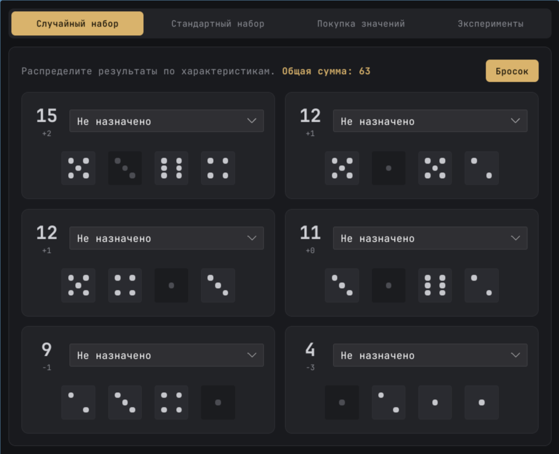

# Stat Forge

Генератор характеристик персонажей D&D 5e. Настольное приложение на Rust и [Slint](https://slint.dev) для Linux, Windows и macOS.



## Возможности

- **Случайный набор.** Шесть бросков «4d6, отбросить наименьший» с анимацией. Результаты распределяются по характеристикам, каждая характеристика назначается один раз.
- **Стандартный набор.** Значения 15, 14, 13, 12, 10, 8 распределяются вручную или по шаблону одного из 12 классов («Книга игрока» 2024).
- **Покупка значений.** 27 очков, значения от 8 до 15, стоимость по таблице 5e. Бюджет можно изменить.
- **Эксперименты.** Наборы бросаются, пока сумма характеристик не достигнет заданного минимума. Показывается, сколько наборов понадобилось. Поиск идёт на всех ядрах процессора и останавливается кнопкой «Стоп».

У каждого значения показан модификатор.

## Скачать

Готовые сборки для Windows и macOS лежат на странице [Releases](https://github.com/HiLute/Stat-Forge/releases).

- **Windows:** распакуйте архив и запустите `Stat Forge.exe`. Сборка не подписана сертификатом, поэтому SmartScreen может предупредить при первом запуске: «Подробнее» → «Выполнить в любом случае».
- **macOS:** распакуйте архив и перенесите `Stat Forge.app` в «Программы». Приложение не нотаризовано Apple, поэтому при первом запуске откройте его через контекстное меню: правый клик → «Открыть». Если macOS пишет, что приложение повреждено, снимите карантин:

  ```sh
  xattr -dr com.apple.quarantine "/Applications/Stat Forge.app"
  ```

Сборка универсальная: работает и на Apple Silicon, и на Intel, macOS 11 и новее.

## Сборка из исходников

### 1. Rust

Нужен Rust 1.95 или новее. Проще всего поставить через [rustup](https://rustup.rs):

```sh
curl --proto '=https' --tlsv1.2 -sSf https://sh.rustup.rs | sh
```

Если Rust уже установлен, обновите его: `rustup update`.

### 2. Системные зависимости

**Linux**

| Дистрибутив | Команда |
|---|---|
| Debian, Ubuntu | `sudo apt install build-essential pkg-config libfontconfig1-dev libxkbcommon-dev` |
| Fedora | `sudo dnf install gcc pkgconf-pkg-config fontconfig-devel libxkbcommon-devel` |
| Arch | `sudo pacman -S base-devel fontconfig libxkbcommon` |

**Windows.** Нужны [Build Tools для Visual Studio](https://visualstudio.microsoft.com/visual-cpp-build-tools/) с рабочей нагрузкой «Разработка классических приложений на C++». В неё входят компилятор MSVC и Windows SDK. Установщик rustup предлагает поставить их сам.

**macOS.** Нужны Xcode Command Line Tools:

```sh
xcode-select --install
```

### 3. Сборка и запуск

```sh
git clone https://github.com/HiLute/Stat-Forge.git
cd Stat-Forge
cargo run --release
```

Готовый исполняемый файл: `target/release/stat-forge`, на Windows `target\release\stat-forge.exe`. Его можно скопировать куда угодно: шрифты и иконки встроены внутрь.

Тесты:

```sh
cargo test
```

### Особенности Linux

На Linux приложение по умолчанию рисует интерфейс процессором. OpenGL-рендер с драйвером NVIDIA на Wayland блокировал приложение, когда окно было скрыто, и композитор показывал «Приложение не отвечает». Чтобы всё же включить рисование через GPU, задайте переменную `SLINT_BACKEND`:

```sh
SLINT_BACKEND=winit-femtovg cargo run --release
```

## Устройство проекта

```
src/rules/      правила без интерфейса: броски, стандартный набор, покупка значений,
                поиск набора с минимальной суммой (threshold.rs)
src/tabs/       связь правил с интерфейсом, по модулю на вкладку
ui/             интерфейс на Slint: тема, виджеты, вкладки, шрифты, иконки
assets/         иконки для сборок Windows (.ico) и macOS (.png → .icns)
packaging/      сборка .app для macOS
```

## Лицензии сторонних ресурсов

Шрифт [JetBrains Mono](https://github.com/JetBrains/JetBrainsMono) распространяется по лицензии SIL Open Font License 1.1, текст в `ui/fonts/OFL.txt`.
